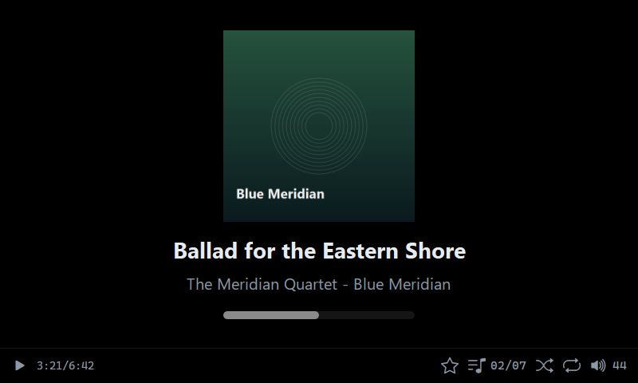
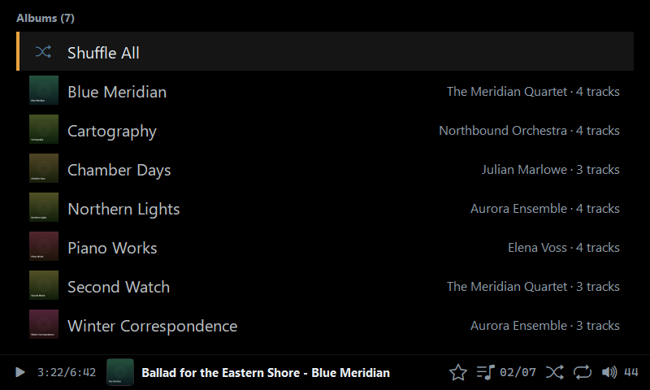
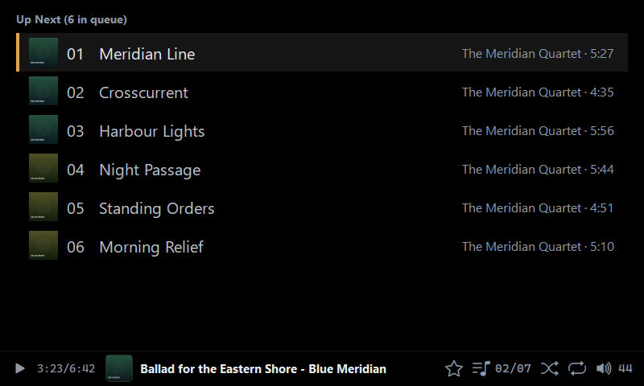

# Headunit

A PySide6 car head-unit style music player for MPD, designed for a fixed
800x480 display and knob-style navigation (keyboard events are the knob
simulation).

## Features

- MPD backend targeting MPD 0.24 (library snapshot, native shuffle/repeat
  state, the `Stared` playlist, multi-disc albums).
- Fast browsing of large libraries: one library snapshot, cached text layouts,
  partial list repaints and pre-scaled cover thumbnails.
- Asynchronous cover caching with an idle "Caching" mode, `Rebuild Cache` and
  `Reload` actions in Settings (the cache size is shown next to the action).
- Now Playing with optional blurred-cover background, Up Next queue, playlist
  and album browsing.
- Connection-loss overlay with retry count and ICMP host ping.
- Audio output selection in Settings (context menu of MPD outputs).
- Configurable 16- or 64-step volume grid (`volume_steps` in the config file).

See [`AGENT.md`](AGENT.md) for the full architecture and behaviour notes.

## Screenshots

Captured with `python main.py --mock`:







## Requirements

- Python 3.10+
- MPD 0.24+ (older versions work with some fallbacks)

```bash
python -m pip install -r requirements.txt
```

## Running

```bash
python main.py           # Use the configured MPD server
python main.py --mock    # In-memory sample library (no server)
python main.py --smoke   # Automated key-routing smoke test
python main.py --debug   # Mirror the debug log to stderr
```

Mock mode is only enabled by `--mock`. If the MPD server is unreachable the
MPD backend stays active and the connection overlay is shown; there is no
automatic fallback to the mock library.

## Configuration

The config is created automatically at `%APPDATA%/headunit/config.json`
(Windows) or `~/.config/headunit/config.json` (elsewhere):

```json
{
  "debug": true,
  "volume_steps": 16,
  "mpd": {
    "host": "127.0.0.1",
    "port": 6600,
    "password": "",
    "timeout": 1000
  }
}
```

`volume_steps` selects the volume grid: `16` for 6.25% per notch or `64` for
1.5625%; invalid values fall back to 16.

`timeout` is the control socket timeout in milliseconds. Bulk library loads and
artwork use longer timeouts internally.

The debug log is written to `headunit.log` next to the config. Cover art is
cached under `cover-cache/`.

## Development media

`media/` contains the icon font and a sample MPD configuration. The generated
music library, playlists and MPD runtime state are not committed; create them
with `tools/generate_library.py` (requires Pillow and ffmpeg) and adjust the
paths in `media/mpd.conf` for your machine.
